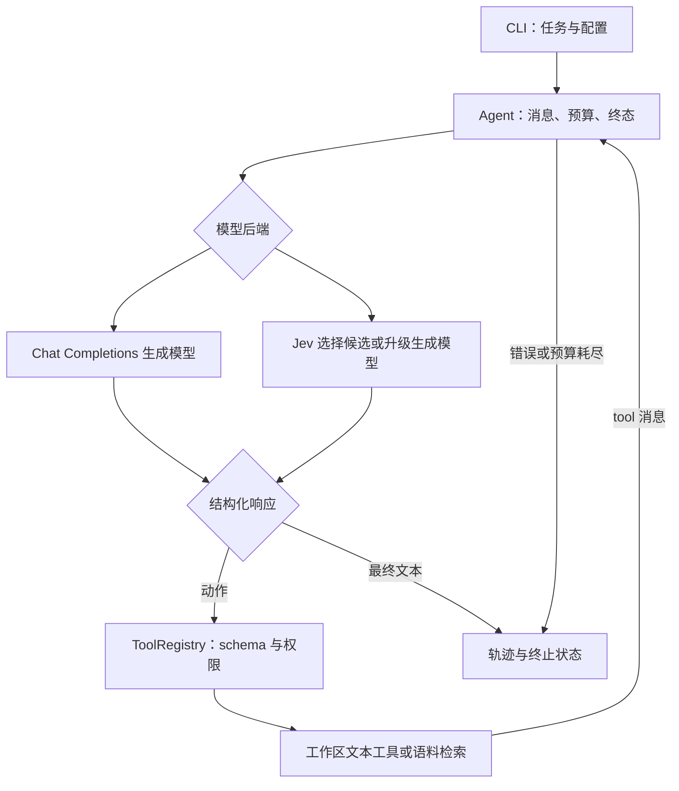

# 架构与源码阅读指南

仓库名为 `Search_Agent_RL`，安装包名为 `search-agent-workbench`，Python 导入名为
`agent_workbench`。应用提供模型调用、搜索和文本工作区执行；旧 Search-R1 的训练环境通过
单独补丁与资产路径衔接，不是日常推理依赖。

## 三个核心契约

| 对象 | 定义位置 | 含义 |
| --- | --- | --- |
| `ToolCall` | [types.py](../src/agent_workbench/types.py) | 待执行动作：唯一 ID、工具名、JSON 参数；模型只提出动作。 |
| `Completion` | [types.py](../src/agent_workbench/types.py) | 一个模型回合：文本、工具动作、停止原因、用量和可选 reasoning 字段。 |
| `Trajectory` | [types.py](../src/agent_workbench/types.py) | 一次任务的消息、事件、终态、最终文本、用量和实验配置。 |

模型后端返回 `Completion`。运行器通过工具注册表执行动作，再把结果以工具角色追加到
`Trajectory`。工具执行权集中在运行器和注册表，模型 HTTP 适配器不操作文件。

## 一次任务如何运行

1. CLI 选择已有工作区、模型、预算和新输出路径；可选注册检索工具和读取候选配置。
2. `Agent.run()` 建立 system/user 消息，检查预算，再调用模型。模型与工具文本始终保留来源。
3. 截断或过滤的响应不会执行动作；重复 ID 和超出预算的整个工具批次也在执行前拒绝。
4. `ToolRegistry.execute()` 检查工具名、写权限和参数 schema，再调用对应处理器。异常转成结构化错误。
5. 工具结果回到同一执行循环；没有工具动作的完整文本成为 `final_answer`。错误、空回答和预算耗尽各自记录状态。

`completed` 只表示收到了完整最终文本，不表示事实正确或业务任务已被独立验证。后者属于
评分器或应用层 verifier 的职责。

## 模块职责与扩展边界

| 模块 | 负责 | 扩展约定 |
| --- | --- | --- |
| [cli.py](../src/agent_workbench/cli.py) | demo/run/index/score/evaluate 的参数装配 | 显式选择能力与输出，不隐藏赋权。 |
| [runtime.py](../src/agent_workbench/runtime.py) | 唯一工具循环、调用顺序、预算、状态 | 不绑定模型名，不导入训练框架。 |
| [models.py](../src/agent_workbench/models.py) | 兼容 HTTP 模型传输、响应解析、fixture | 只产生响应；密钥来自环境变量，错误不回显私有响应体。 |
| [jev.py](../src/agent_workbench/jev.py) | typed decision 请求、概率与返回值校验 | 选项概率不是任务成功率，更不能替代授权。 |
| [cooperation.py](../src/agent_workbench/cooperation.py) | 候选选择、避免重复、升级推理 | 快速路径仅接受绑定完整参数的内置只读动作。 |
| [tools.py](../src/agent_workbench/tools.py) | 工具 schema、注册、文本文件操作 | 路径受限、创建不覆盖、写入须显式授权。 |
| [retrieval.py](../src/agent_workbench/retrieval.py) | JSONL 建索引、SQLite FTS5 查询 | 后端明确命名，不静默变成旧 Lucene/bm25s。 |
| [evaluation.py](../src/agent_workbench/evaluation.py) | 固定预测 EM/F1、完整分母、哈希 | 不根据 gold 选择预测改写。 |
| [benchmark.py](../src/agent_workbench/benchmark.py) | direct/RAG/agent 协议、逐题记录 | gold 不进入模型上下文；失败不从分母消失。 |
| [training.py](../src/agent_workbench/training.py) | 带角色来源的文本轨迹导出 | `trainer_ready=False`；需要另接 token/logprob 采样信息。 |
| [patch_legacy.py](../scripts/patch_legacy.py) | 旧四文件补丁生成、审阅、备份与应用 | 默认 dry-run，源码漂移和审阅哈希不符时拒绝。 |

## Jev 与 Qwen 的实际协作

现有实现是 **Jev 快速闭集选择 + Qwen 或其他兼容模型推理生成**。System 1/2 只是职责
比喻：前者快选，后者承担较重的思考；不能据此推断模型内部认知机制。

[候选配置](../configs/read-notes-candidates.json) 包含工具名与完整参数。Jev 选择动作，或
选择 `reason` 交给生成模型；候选耗尽、概率不足、服务异常或状态过大也升级。已尝试的相同
工具/参数组合不会再次进入快速候选集。没有候选时，不额外调用 Jev。

尚未实现 Qwen 自动生成和维护可复用计划，也没有学习式路由或双系统 RL。设计和对照条件见
[双系统说明](dual-system.md)。

## 读懂轨迹

普通 `run --trace` 生成 JSON：`messages` 是实际消息，`events` 是调用、耗时和错误，
`status` 是退出原因，`metadata` 记录配置。端点提供的 `reasoning_content` 会保留供工具
回传，它同样可能包含私密内容。

QA 评估创建新目录：

| 文件 | 用途 |
| --- | --- |
| `manifest.json` | 数据/索引哈希、协议、模式、条数、生成配置。 |
| `predictions.jsonl` | 每题预测、gold、状态、用量；逐题 flush。 |
| `traces.jsonl` | 每次运行轨迹；逐题 flush。 |
| `summary.json` | 完整结束后写入指标、状态计数和 token 总量。 |

评估中断后保留的行不等于全量完成；目前不能自动续评。轨迹和预测可能含问题、资料及
推理文本，默认输出到被忽略的 `runs/`，不要直接提交私有运行结果。

## 推荐阅读顺序

先运行 README 的离线 demo，再按 `types.py → runtime.py → tools.py → models.py`
阅读，并对照 [test_core.py](../tests/test_core.py)。研究检索评估时读
`retrieval.py → evaluation.py → benchmark.py`；研究协作时读
`cooperation.py → jev.py → test_cooperation.py`。最后读旧补丁与 [RL 路线](rl-roadmap.md)，
避免把文本轨迹导出误认为训练器已经实现。
